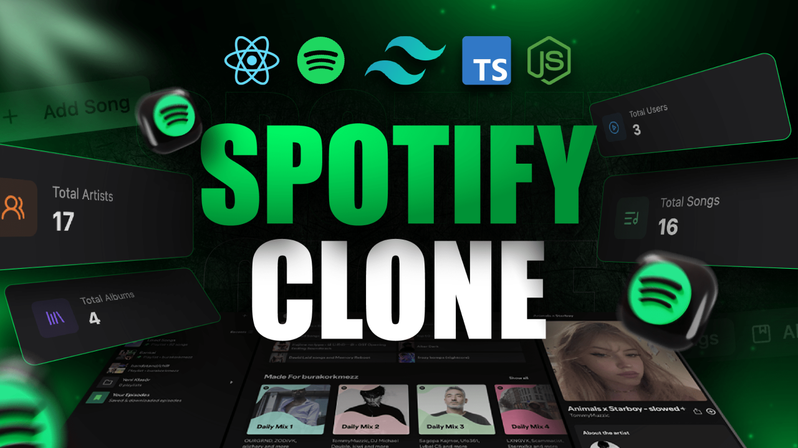

<h1 align="center">✦ Jukebox.io ✦</h1>
<p align="center">
  <strong>Real-time Music Streaming & Social Audio Platform — The Midnight Aurora Experience</strong>
</p>

<p align="center">
  
</p>

---

## 🌌 Overview

**Jukebox.io** is a full-stack, real-time music streaming platform built for high-fidelity audio playback and interactive community listening. Designed with a futuristic **Midnight Aurora** aesthetic, Jukebox.io pairs smooth audio streaming with real-time peer presence, live chat, interactive queuing, and an administrative studio.

---

## ✨ Features

- **🎧 Seamless Audio Engine**: Lossless audio playback, seekable waveform progress, automated track queues, real-time shuffle, and loop repeat modes.
- **⌨️ Native Media Session API**: Support for hardware media keys (play/pause/prev/next), lock-screen controls, and system notifications across desktop and mobile.
- **💬 Real-Time Chat & Radar**: Integrated chat powered by Socket.io with live online/offline indicators and real-time listening status.
- **🛡️ Secure Identity & RBAC**: Authentication handled via Clerk JWT with automatic session refresh and role-based admin controls.
- **🎛️ Aurora Admin Studio**: Cloudinary-powered media upload for tracks and master albums, with automated audio duration detection and catalog management.
- **🔍 Universal Sonic Search**: Client & server-indexed soundscape discovery across songs, artists, and master albums.
- **🎨 Midnight Aurora Design**: Glassmorphic UI with dynamic animated equalizers, glowing gradients, and responsive Radix UI primitives.

---

## 🛠️ Tech Stack

### Frontend
- **Framework**: React 18 with Vite & TypeScript
- **State Management**: Zustand
- **Styling**: Tailwind CSS, PostCSS, Radix UI Primitives, Lucide Icons
- **Real-Time & Networking**: Socket.io-client, Axios with dynamic token interceptors
- **Authentication**: `@clerk/clerk-react`

### Backend
- **Runtime & Server**: Node.js, Express.js (ES Modules)
- **Database**: MongoDB with Mongoose ODM
- **Real-Time Engine**: Socket.io
- **Cloud Storage**: Cloudinary (Audio & Artwork CDN)
- **Authentication & Security**: `@clerk/express`, CORS

---

## 🚀 Getting Started

### 1. Prerequisites
- [Node.js](https://nodejs.org/) (v18.0.0 or higher)
- [MongoDB](https://www.mongodb.com/) (Local instance or MongoDB Atlas URI)
- [Clerk Account](https://clerk.com/) for authentication
- [Cloudinary Account](https://cloudinary.com/) for audio/image storage

---

### 2. Clone the Repository
```bash
git clone https://github.com/Sohammore13/Jukebox.io.git
cd Jukebox.io
```

---

### 3. Environment Variables Configuration

#### Backend (`backend/.env`)
Create a `.env` file in the `backend/` directory:
```env
PORT=5000
MONGODB_URI=your_mongodb_connection_string
ADMIN_EMAIL=your_clerk_admin_email
NODE_ENV=development
CLIENT_URL=http://localhost:5173

# Cloudinary
CLOUDINARY_API_KEY=your_cloudinary_api_key
CLOUDINARY_API_SECRET=your_cloudinary_api_secret
CLOUDINARY_CLOUD_NAME=your_cloudinary_cloud_name

# Clerk Auth
CLERK_PUBLISHABLE_KEY=your_clerk_publishable_key
CLERK_SECRET_KEY=your_clerk_secret_key
```

#### Frontend (`frontend/.env`)
Create a `.env` file in the `frontend/` directory:
```env
VITE_CLERK_PUBLISHABLE_KEY=your_clerk_publishable_key
```

---

### 4. Install Dependencies

```bash
# Install root, backend, and frontend dependencies
npm install --prefix backend
npm install --prefix frontend
```

---

### 5. Seed Initial Audio & Albums (Optional)

Populate your database with starter tracks and albums:
```bash
npm run seed:songs --prefix backend
npm run seed:albums --prefix backend
```

---

### 6. Run the Application

#### Start Backend Server:
```bash
npm run dev --prefix backend
# Server runs on http://localhost:5000
```

#### Start Frontend Client:
```bash
npm run dev --prefix frontend
# Client runs on http://localhost:5173
```

---

## 📦 Production Build

```bash
# Build the frontend and install production dependencies
npm run build

# Start the full-stack production server
npm start
```

---

## 🔒 Security & Best Practices

- **Token Refresh**: Axios interceptors automatically attach fresh Clerk JWT session tokens to prevent `401 Unauthorized` token expiry.
- **Asset Lifecycle**: Cloudinary audio and image assets are safely removed upon track or album deletion to prevent orphaned storage.
- **Multi-Tab Presence**: Socket.io user sessions are managed with room-based multiplexing, preventing multi-tab disconnections.
- **Database Optimization**: Compound indexes on messages and full-text indexes on song titles and artists ensure sub-millisecond query responses.

---

## 📄 License
This project is licensed under the ISC License.
